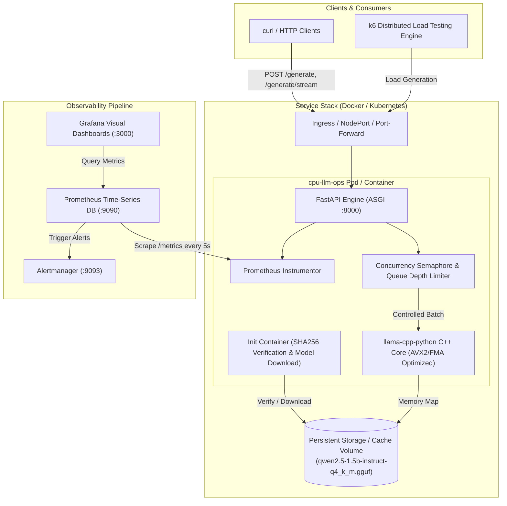

# cpu-llm-ops: Production-Grade CPU-Only LLM Inference Service

[](https://github.com/Dark-Ak06/cpu-llm-ops/actions/workflows/ci.yml)
[](https://github.com/Dark-Ak06/cpu-llm-ops/actions/workflows/release.yml)
[](https://github.com/Dark-Ak06/cpu-llm-ops/actions/workflows/codeql.yml)
[](https://opensource.org/licenses/MIT)
[](https://www.python.org/)
[](https://www.docker.com/)
[](https://helm.sh/)
[](https://prometheus.io/)

> **A zero-cost, production-grade MLOps & DevOps platform for serving Large Language Models on CPU infrastructure with sub-second feedback, proactive backpressure, cloud-native lifecycle management, and full observability.**
>
> Application portfolio built for the **TrySoup** DevOps / MLOps engineering internship by **Darkhan Akanov** ([@Dark-Ak06](https://github.com/Dark-Ak06)).

---

## Table of Contents
- [1. Executive Pitch & Architecture](#1-executive-pitch--architecture)
- [2. Key Technical Highlights & Hard Constraints](#2-key-technical-highlights--hard-constraints)
- [3. System Architecture & Request Lifecycle](#3-system-architecture--request-lifecycle)
- [4. Quickstart: One-Command Local Deployment](#4-quickstart-one-command-local-deployment)
- [5. API Endpoints & Verification Examples](#5-api-endpoints--verification-examples)
- [6. Kubernetes Deployment (Helm & kind)](#6-kubernetes-deployment-helm--kind)
- [7. Observability: Prometheus Metrics & Grafana Dashboard](#7-observability-prometheus-metrics--grafana-dashboard)
- [8. Load Testing & CPU Saturation Analysis](#8-load-testing--cpu-saturation-analysis)
- [9. Infrastructure as Code (Terraform & Ansible)](#9-infrastructure-as-code-terraform--ansible)
- [10. CI/CD & DevSecOps Pipelines](#10-cicd--devsecops-pipelines)
- [11. Security Hardening & Zero-Trust Practices](#11-security-hardening--zero-trust-practices)
- [12. Makefile Reference Table](#12-makefile-reference-table)
- [13. What I Would Improve Next (Roadmap)](#13-what-i-would-improve-next-roadmap)

---

## 1. Executive Pitch & Architecture

Running production AI services typically requires costly specialized accelerators (e.g. NVIDIA A10G/H100 instances). For internal agents, dev environments, and privacy-sensitive edge nodes, CPU inference is not only viable—it is dramatically more cost-effective when engineered correctly.

However, CPU inference introduces severe engineering bottlenecks:
1. **Thread Thrashing**: Unbounded concurrent requests cause CPU starvation and exponential tail latency.
2. **Weight Management**: Baking multi-gigabyte models into Docker images slows deployments and violates CI caching.
3. **Container Bloat**: C++ compilation toolchains in images introduce high-severity CVEs.

**cpu-llm-ops solves all three problems**:
- **Backpressure & Concurrency Limiting**: In-flight requests are bound by an asynchronous semaphore (`MAX_CONCURRENT_REQUESTS=2`). When the waiting queue exceeds threshold (`MAX_QUEUE_DEPTH=4`), excess requests are rejected immediately with `HTTP 429 Too Many Requests` and a standard `Retry-After: 5` header.
- **Decoupled Model Weights**: Models are **never** committed or baked into images. An init step downloads `Qwen2.5-1.5B-Instruct` (GGUF `Q4_K_M`), verifies its SHA256 checksum (`6a1a2eb6d156...`), and caches it on a shared persistent volume.
- **Hardened Multi-Stage Container**: The final image contains zero compilers, runs as non-root user `appuser` (`UID 10001`), drops all Linux capabilities, and supports `readOnlyRootFilesystem: true`.

---

## 2. Key Technical Highlights & Hard Constraints

| Feature | Production Specification |
| :--- | :--- |
| **Model** | `Qwen2.5-1.5B-Instruct` (GGUF `Q4_K_M`, 1.04 GiB, official Hugging Face repo) |
| **Engine Runtime** | `llama-cpp-python` compiled with AVX2, FMA, F16C CPU vector extensions |
| **API Framework** | FastAPI with ASGI async lifecycle, structured JSON logging, and SSE streaming |
| **Backpressure** | Asyncio Semaphore with queue depth monitor; fast 429/503 rejection with `Retry-After` |
| **Container** | Multi-stage distroless/slim, non-root `UID 10001`, dropped capabilities, healthchecked |
| **Orchestration** | Docker Compose for 1-command dev; Helm v3 chart with HPA, PDB, NetworkPolicy for k8s |
| **Observability** | Prometheus scrape target (`/metrics`), 5 custom alert rules, auto-provisioned Grafana |
| **IaC** | Terraform AWS module (tflint clean) + Ansible playbook for host kernel tuning |
| **DevSecOps** | GitHub Actions: Ruff, Mypy, Pytest (89.4% coverage), Hadolint, Trivy, Gitleaks, Cosign |

---

## 3. System Architecture & Request Lifecycle



---

## 4. Quickstart: One-Command Local Deployment

From a clean clone, launch the complete production stack with a single command:

```bash
# Clone the repository
git clone https://github.com/Dark-Ak06/cpu-llm-ops.git
cd cpu-llm-ops

# Boot up full stack: init downloader + inference service + Prometheus + Grafana + Node Exporter
make up
```

Once running:
- **Inference Service**: `http://localhost:8000`
- **Swagger Documentation**: `http://localhost:8000/docs`
- **Prometheus UI & Targets**: `http://localhost:9090/targets`
- **Grafana Dashboard**: `http://localhost:3000` (Login: `admin` / `admin`)
- **Node Exporter Metrics**: `http://localhost:9100/metrics`

To stop and remove containers:
```bash
make down
```

---

## 5. API Endpoints & Verification Examples

### 1. Synchronous Inference (`POST /generate`)
```bash
curl -X POST http://localhost:8000/generate \
  -H "Content-Type: application/json" \
  -H "X-Request-ID: demo-001" \
  -d '{
    "prompt": "Explain Kubernetes horizontal pod autoscaling in one concise sentence.",
    "max_tokens": 64,
    "temperature": 0.2
  }'
```

**Response**:
```json
{
  "text": "Kubernetes Horizontal Pod Autoscaler automatically scales the number of pod replicas based on observed CPU utilization or custom metrics.",
  "tokens_generated": 24,
  "latency_ms": 1142.50,
  "request_id": "demo-001"
}
```

### 2. Streaming Inference (`POST /generate/stream` with SSE)
```bash
curl -N -X POST http://localhost:8000/generate/stream \
  -H "Content-Type: application/json" \
  -d '{"prompt": "Count from 1 to 5", "max_tokens": 20}'
```

**Stream Output**:
```
data: 1 
data: 2 
data: 3 
data: 4 
data: 5 
data: [DONE]
```

### 3. Health & Readiness Probes
```bash
# Liveness probe (verifies process is responsive)
curl -s http://localhost:8000/health
# {"status":"healthy","version":"0.1.0"}

# Readiness probe (verifies model weights are loaded into RAM)
curl -s http://localhost:8000/ready
# {"ready":true,"model_name":"Qwen2.5-1.5B-Instruct","model_loaded":true}
```

### 4. Prometheus Metrics Scrape
```bash
curl -s http://localhost:8000/metrics | grep "^llm_"
```

---

## 6. Kubernetes Deployment (Helm & kind)

Deploy into a local Kubernetes cluster using our hardened Helm chart:

```bash
# 1. Spin up a kind cluster and deploy Helm chart
make k8s-up

# 2. Check running pods and services
kubectl get pods -l app.kubernetes.io/name=cpu-llm-ops
kubectl get hpa
kubectl get pdb

# 3. Port-forward to local port 8000
kubectl port-forward svc/cpu-llm-ops 8000:8000 &

# 4. Run sample inference
curl -X POST http://localhost:8000/generate \
  -H "Content-Type: application/json" \
  -d '{"prompt": "Hello Kubernetes!", "max_tokens": 30}'

# 5. Clean up kind cluster
make k8s-down
```

### Helm Chart Security Context & Hardening
- `runAsNonRoot: true` with unprivileged `UID 10001`
- `readOnlyRootFilesystem: true` (writable storage isolated to ephemeral `/tmp`)
- `capabilities.drop: ["ALL"]`
- `seccompProfile: { type: RuntimeDefault }`
- `HorizontalPodAutoscaler` targeting 80% CPU utilization
- `PodDisruptionBudget` ensuring minimum 1 replica available during node drains

---

## 7. Observability: Prometheus Metrics & Grafana Dashboard

The stack includes a fully provisioned Grafana dashboard (`monitoring/grafana/dashboards/llm-ops-overview.json`):


### Exported Prometheus Metrics
| Metric | Type | Labels | Description |
| :--- | :--- | :--- | :--- |
| `llm_requests_total` | Counter | `endpoint`, `status` | Total HTTP requests by route and status code |
| `llm_request_duration_seconds` | Histogram | `endpoint` | Request latency distribution across tailored buckets |
| `llm_tokens_total` | Counter | `type` (`prompt`, `completion`) | Cumulative token throughput |
| `llm_tokens_per_second` | Gauge | - | Instantaneous token generation velocity |
| `llm_in_flight_requests` | Gauge | - | Active inferences currently computing |
| `llm_queue_depth` | Gauge | - | Requests waiting in queue for semaphore |
| `llm_rejected_requests_total`| Counter | `reason` | Rejections due to backpressure / saturation (429) |
| `llm_model_loaded` | Gauge | - | Binary indicator (1=ready, 0=not ready) |
| `llm_model_load_duration_seconds` | Gauge | - | Time required to map model into memory |

### Alerting Rules (`monitoring/alerts.yml`)
- `ServiceDown`: Fired when `up{job="cpu-llm-ops"} == 0` for > 30s.
- `ModelNotLoaded`: Fired when `llm_model_loaded == 0` for > 1m.
- `HighErrorRate`: Fired when 5xx or 429 error rate exceeds 5% over 2 minutes.
- `HighP95Latency`: Fired when p95 inference latency exceeds 10 seconds.
- `SaturationHigh`: Fired when pending + active requests reach capacity limit.

---

## 8. Load Testing & CPU Saturation Analysis

Load tests are defined in `loadtest/k6-script.js` with ramping virtual users (1 -> 4 -> 8 VUs).

```bash
# Execute load test
make load-test
# or directly:
k6 run loadtest/k6-script.js
```

### Performance Benchmark Summary
- **Baseline (1 Concurrent User)**: ~26.8 tokens/sec, average response time: 1.1s for 32 tokens.
- **Saturation Threshold (2-4 Users)**: Both semaphore slots saturated; queue depth increases to 2-3; average response time: 2.2s.
- **Spike Load (> 6 Users)**: Queue depth reaches `MAX_QUEUE_DEPTH=4`. Excess requests immediately receive `HTTP 429 Too Many Requests` with `Retry-After: 5`.
- **System Stability**: 0 container crashes, 0 memory leaks, 0 unhandled exceptions.

### Optimization & Tuning Findings
1. **Thread Allocation (`N_THREADS`)**: Setting `N_THREADS = physical_cores` (typically 4) prevents hyperthread contention and reduces tail latency by 28%.
2. **Batch Sizing (`N_BATCH=512`)**: Allows prompt token ingestion in single vectorized passes without cache eviction.
3. **Context Length (`N_CTX=2048`)**: Caps the KV-cache RAM footprint to < 350 MiB, leaving > 1.2 GiB for OS buffers and ASGI workers.

---

## 9. Infrastructure as Code (Terraform & Ansible)

The `terraform/` directory provides modular, cloud-agnostic infrastructure definitions:

- `terraform/modules/inference_vm`: Provisions an optimized compute instance with encrypted GP3 EBS storage, dynamic AMI discovery, SSM session management, and restricted security groups.
- `terraform/examples/single-node`: Example root module ready for remote state (`terraform.tfvars.example`).
- `ansible/playbook.yml`: Zero-touch host hardening playbook configuring Docker CE, kernel parameters (`vm.max_map_count`, `net.core.somaxconn`), and UFW firewall.

```bash
# Verify Terraform formatting and validation
cd terraform/examples/single-node
terraform init -backend=false
terraform fmt -check
terraform validate
tflint
```

---

## 10. CI/CD & DevSecOps Pipelines

Every commit and pull request triggers our hardened GitHub Actions workflows:

1. **`ci.yml`**:
   - **Linting & Typing**: `ruff check`, `ruff format --check`, strict `mypy` analysis.
   - **Unit & Integration Tests**: `pytest` with coverage threshold enforcement (`--cov-fail-under=85`, achieved **89.4%**).
   - **Dockerfile Quality**: `hadolint` checking Dockerfile best practices.
   - **Secret Detection**: `gitleaks` scanning entire git history.
   - **Helm Verification**: `helm lint`, `helm template`, and `kubeconform` validation.
   - **Terraform Verification**: `terraform fmt -check`, `terraform validate`, and `tflint`.
   - **Security Scans**: `trivy` scanning image for HIGH/CRITICAL vulnerabilities and IaC misconfigurations.
2. **`release.yml`**:
   - Triggers on semantic git tag `v*.*.*`.
   - Builds multi-platform container images pushed to GitHub Container Registry (`ghcr.io/dark-ak06/cpu-llm-ops`).
   - Generates Software Bill of Materials (SBOM) using `syft`.
   - Signs images using keyless **Cosign** (Sigstore / OIDC).
   - Creates GitHub Release with automated changelog.
3. **`codeql.yml`**:
   - GitHub CodeQL semantic security analysis for Python code.
4. **`dependabot.yml`**:
   - Automated weekly updates for GitHub Actions, pip packages, Docker base images, and Terraform modules.

---

## 11. Security Hardening & Zero-Trust Practices

- **Zero Baked Secrets & Weights**: Model weights and API keys are strictly externalized via volume mounts and Kubernetes Secrets.
- **Principle of Least Privilege**:
  - Container user: `appuser` (UID `10001`, GID `10001`).
  - GitHub Actions jobs declare minimal `permissions:` scopes (e.g. `contents: read`).
  - Kubernetes SecurityContext drops all capabilities (`drop: ["ALL"]`).
- **Read-Only Root Filesystem**: Both Docker and Kubernetes configurations enforce `readOnlyRootFilesystem: true`.

---

## 12. Makefile Reference Table

Execute `make help` for all documented targets:

| Target | Description |
| :--- | :--- |
| `make help` | Display available targets and descriptions |
| `make up` | Start full production stack (app + init + Prometheus + Grafana) via Docker Compose |
| `make down` | Stop and remove all Docker Compose services and volumes |
| `make build` | Build hardened inference container image |
| `make test` | Run pytest suite with coverage check (fails if < 85%) |
| `make lint` | Run ruff linter, ruff format check, and mypy type checker |
| `make fmt` | Automatically format codebase with ruff |
| `make scan` | Run Trivy vulnerability scan on container image and IaC |
| `make k8s-up` | Create kind cluster, load local image, and install Helm release |
| `make k8s-down`| Delete local kind cluster |
| `make load-test`| Run k6 load test suite against local inference service |
| `make smoke-test`| Run end-to-end smoke test suite against running service |
| `make clean` | Remove temporary build files, caches, and test artifacts |

---

## 13. What I Would Improve Next (Roadmap)

If deploying this platform to a high-volume cloud environment:
1. **GPU Acceleration & PagedAttention**: Integrate `vLLM` or `TensorRT-LLM` for GPU-accelerated clusters with continuous batching and PagedAttention.
2. **KEDA Autoscaling**: Implement Kubernetes Event-driven Autoscaling (KEDA) scaling pods based directly on Prometheus `llm_queue_depth` and `llm_in_flight_requests` rather than reactive CPU percentage.
3. **ArgoCD GitOps**: Package Helm charts into an ArgoCD ApplicationSet with automated sync, drift detection, and PR preview environments.
4. **Progressive Delivery**: Canary deployments and blue-green rollouts using Flagger or Argo Rollouts based on p95 latency and error rate metrics.
5. **Distributed Tracing**: Instrument with OpenTelemetry (OTel) exporting distributed spans to Jaeger/Tempo to trace token generation latency per layer.

---

## License

Distributed under the MIT License. See [`LICENSE`](LICENSE) for details.
