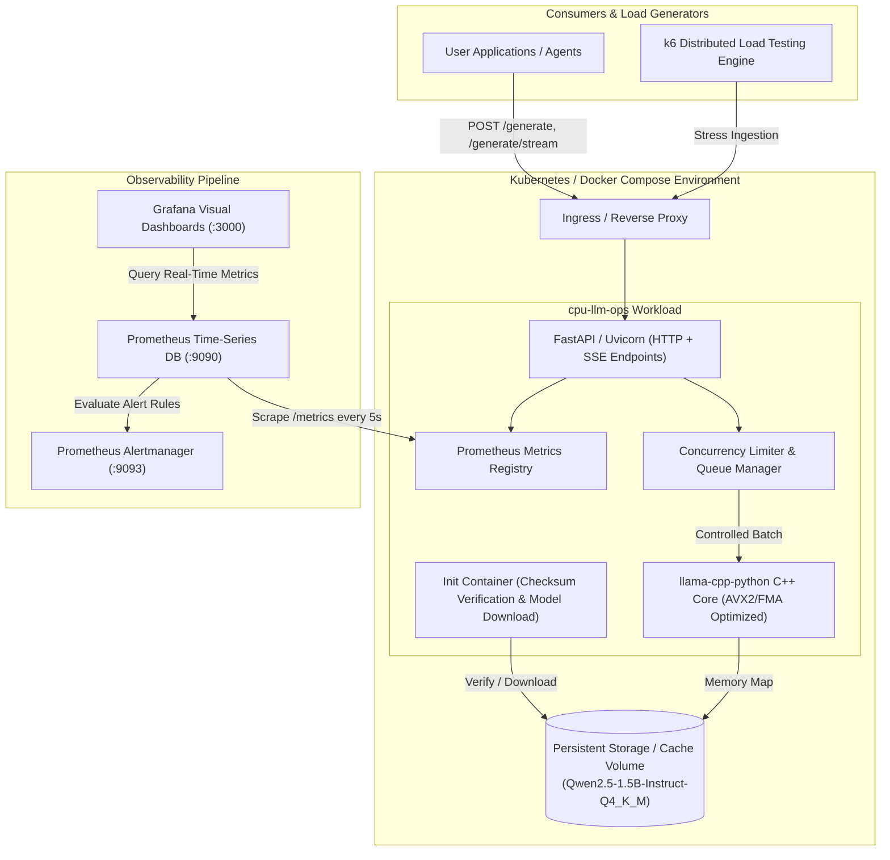
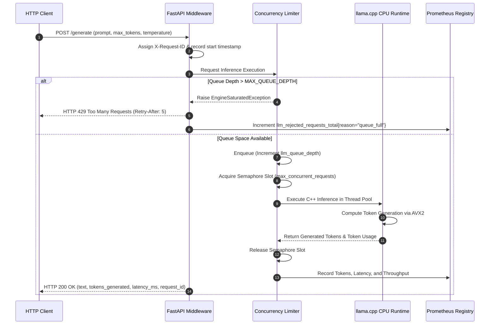
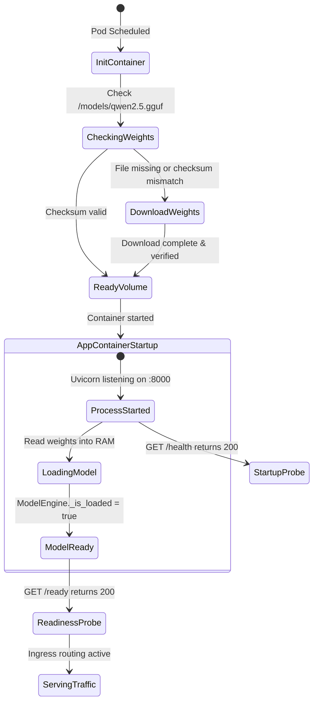

# cpu-llm-ops Architecture Reference

## High-Level Architecture Overview

---

## Inference Request Lifecycle & Backpressure Control

---

## State Diagram: Pod Lifecycle & Health Probes

---

## Hardening & Security Boundaries

1. **Non-Root Execution**: Runs under UID `10001` (`appuser`) and GID `10001`.
2. **Read-Only Root Filesystem**: Implemented with explicit `readOnlyRootFilesystem: true`. Writable areas are isolated to ephemeral `emptyDir` mounts (`/tmp`).
3. **Capabilities**: Dropped all Linux capabilities (`CAP_DROP ALL`).
4. **Network Boundaries**: Ingress restricted to HTTP service port; egress restricted to CoreDNS (:53) and external HTTPS (:443) for initial model downloads.
